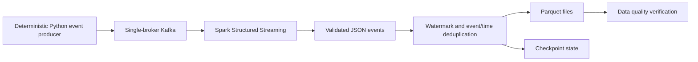

# Architecture, validation, and production considerations

## Local test topology

This repository deliberately uses **one broker** and a local Spark driver. It is not high availability or a deployment template.

## Data contract and quality gate

Expected fields: `event_id`, `event_time` (ISO-8601 UTC), `store_id`, `product_id`, positive `quantity`, positive `unit_price`. Invalid or missing primary fields are filtered before the sink. The CI integration test sends **60 deterministic synthetic events** and requires:

- 60 Parquet records and 60 distinct event IDs
- Exactly the expected generated event IDs, no missing or extra IDs
- No null event IDs, timestamps, stores, products or invalid numeric values

The test fails if the required checks do not hold; GitHub Actions retains the JSON summary when produced.

## Delivery guarantees

The producer uses Kafka acknowledgement settings and waits for delivery. Kafka can deliver duplicates on retry. The Spark demo deduplicates the pair `(event_id, event_ts)` using a 10-minute event-time watermark, not a globally unique event ID. This demo does **not** guarantee exactly-once delivery across arbitrary failures or consumer replays; behavior relies on checkpoint continuity and sink semantics. It also does not implement a dead-letter queue.

## Production migration checklist

1. Multiple secured Kafka brokers, replication, SASL/TLS, quotas and retention policies.
2. Versioned schemas and contracts, validated event-time bounds, explicit corrupt-record handling and DLQ.
3. Stable checkpoint storage with monitored recovery procedures and idempotent downstream consumers.
4. Metrics and alerts for Kafka consumer lag, micro-batch processing time, failed rows, and data freshness.
5. Load testing with measured throughput, backpressure behavior and realistic event-time skew.
6. Secrets management, restricted service accounts, encryption, CI integration gates and reproducible deployments.

No throughput, availability, or latency claims should be made until measured in a documented environment.
